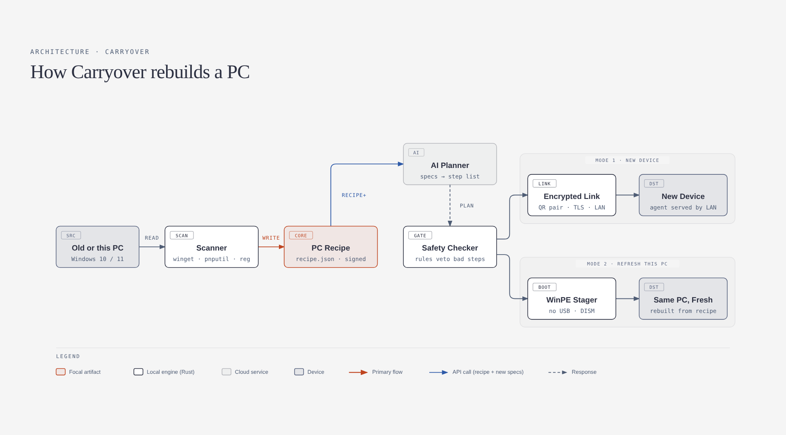

# Carryover

Set up a new or freshly reset PC from your old one. Carryover scans what you have and puts your apps, settings, drivers and files back for you.



## What works today (preview, read-only)

- **Scan** this PC into a PC Recipe: hardware, disks and BitLocker state, apps (with winget IDs when available), third-party drivers (flags the storage driver Windows Setup needs), and your files (names and sizes only).
- **Two modes**: *Set up a new device* and *Refresh this PC* (fresh Windows, no USB stick).
- **Plan** the rebuild, fitted to the target machine's specs (RAM, disk space, GPU and maker changes).
- **Organize my files**: optional tidy-up of loose Desktop and Downloads files into folders. Never deletes, never overwrites, flags duplicates only.
- **Safety checker**: 13 fixed rules every plan must pass, whoever wrote it (rules or AI). Try "Try a risky AI plan" on the plan screen to watch it block one.
- **Save the recipe** as a JSON file with an integrity hash.

Nothing is executed yet: the Start button is disabled until the runner ships.

## Run it on Windows

One-time setup:

1. Install [Node.js 20+](https://nodejs.org).
2. Install [Rust](https://rustup.rs) (default MSVC toolchain).
3. Install the "Desktop development with C++" workload from [Visual Studio Build Tools](https://visualstudio.microsoft.com/visual-cpp-build-tools/).
4. WebView2 is already part of Windows 11.

Then:

```powershell
cd app
npm install
npm run tauri dev      # opens the app with hot reload
```

Without admin rights the scan still works, but the TPM state is missing. The release
app offers a "Restart as administrator" button (Windows asks for permission); in
`npm run tauri dev`, run PowerShell as administrator instead.

If the winget PowerShell module isn't installed, Carryover asks `winget.exe` (built into
Windows 11) which apps it can reinstall and matches them to your installed programs.

Release build (portable `carryover.exe` in `target/release/`, plus an installer):

```powershell
cd app
npm run tauri build
```

UI only, in a browser with sample data: `cd app && npm run dev`, then open http://localhost:1420.

## Tests

```powershell
cargo test -p carryover-core
cargo clippy --workspace --all-targets -- -D warnings
cargo run -p carryover-core --example scan_check   # real scan of this PC, with checks
```

Clean-room Linux run (build, all tests, release build, and two WebDriver suites that drive
the real app, including race and small-window checks): see `docker/Dockerfile`.
Windows: `.github/workflows/ci.yml` runs the real scanner and builds `carryover.exe`.

## Layout

```
crates/core      scanner, recipe, planner, safety checker, spec fit, organizer (pure Rust, tested)
  src/scan/scan.ps1   the read-only PowerShell scanner, embedded at build time
app/src          React UI
app/src-tauri    Tauri shell; the web layer has no filesystem, shell or HTTP permissions
landing          marketing site (open with: cd landing && npm run dev)
docs             architecture diagram
```

## Price

Free. Every feature, no account, no limits, no ads.

If Carryover saved you an evening, consider giving to children in Gaza through the
[Palestine Children's Relief Fund](https://www.pcrf.net/donate/gazareliefandrecovery.html).
Carryover takes nothing from donations.

## Licence

All rights reserved.
