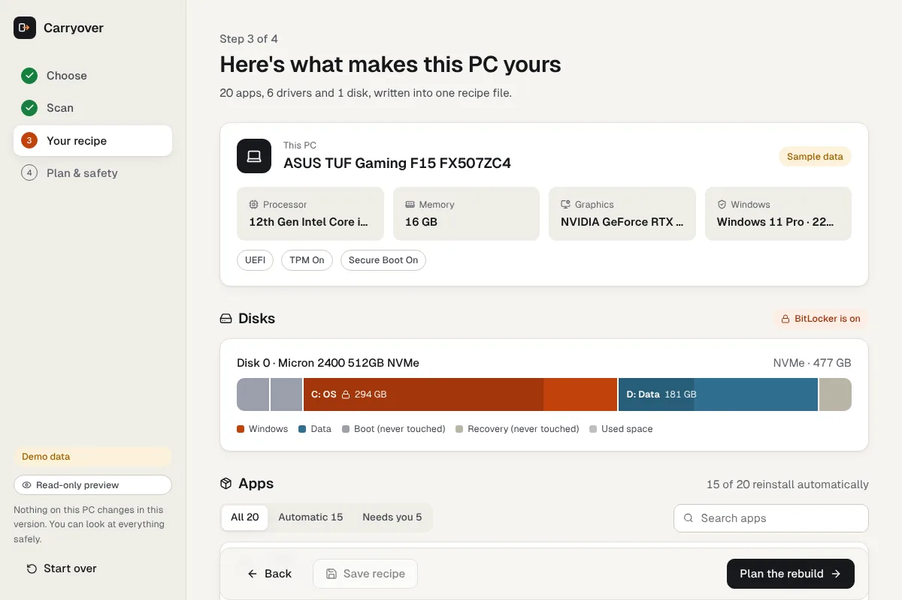
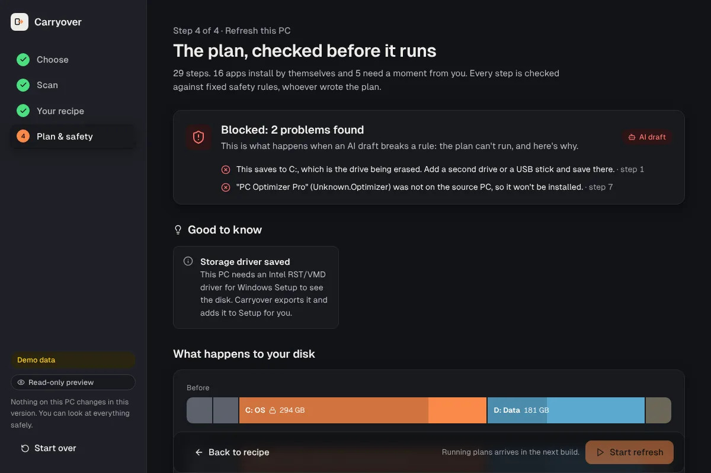

<p align="center">
  
</p>

<h1 align="center">Carryover</h1>

<p align="center">
  Move to a new Windows PC, or reinstall Windows on this one, without losing your apps, drivers or files.<br>
  Free. No account. No USB stick.
</p>

<p align="center">
  <a href="https://github.com/MuhammadHassan03/Carryover/releases/latest"><b>Download for Windows</b></a>
  ·
  <a href="docs/architecture.png">How it works</a>
  ·
  <a href="https://www.pcrf.net/donate/">Donate to PCRF</a>
</p>

<p align="center">
  
</p>

## Why

Setting up a PC again takes a day. You hunt for installers, forget which driver the touchpad needed, copy files to a drive, make a Rufus stick, guess which partition to erase, and then find out a week later that something didn't come across.

Carryover reads your PC once and writes down what makes it yours. Then it builds a plan for the move, and a separate safety checker reads that plan before anything runs.

## Two jobs

| | What happens |
|---|---|
| **Set up a new device** | Scans this PC, compares it with the new one (memory, disk, graphics, maker) and plans what to install and copy over. Nothing on the old PC is erased. |
| **Refresh this PC** | Backs up your files to another drive, saves your BitLocker key, exports drivers, then reinstalls Windows from a recovery image it stages itself. No USB needed. |

There is also an optional **Organize my files** switch. It sorts loose files in Desktop, Downloads and Documents into folders. It only moves files inside your own folders, never deletes and never overwrites.

## What it reads

- **Apps**, with the winget ID for each one that can be reinstalled automatically. Licensed apps (Office, Adobe) and hardware tools are listed as "needs you".
- **Drivers** that Windows doesn't ship with, exported so they can be added back.
- **Disks and partitions**, including the EFI and recovery partitions it must never touch.
- **BitLocker** state, so the key is saved and protection is suspended before a reinstall.
- **Your files** in the user folders: names, sizes and dates only, never the contents. Cloud-only OneDrive files are skipped.

The result is a "recipe" you can save as a file and keep.

## The safety checker

The plan can come from simple rules or from an AI planner. Either way, it goes through 13 checks written in plain Rust before you can start. If one fails, the plan is blocked and you see why.

<details>
<summary>All 13 rules</summary>

1. Every disk and partition a step names exists on this PC.
2. EFI, reserved and recovery partitions are never staged on or erased.
3. Only the Windows volume may be erased, and only once.
4. The recipe, keys and drivers are never saved to the volume being erased.
5. The recipe, BitLocker key and drivers are saved before anything is erased.
6. BitLocker is suspended before Windows is reinstalled.
7. Storage drivers are exported and added back so Setup can see the disk.
8. Only apps found on the source PC can be installed.
9. New-device plans never erase anything on this PC.
10. Every drive letter a step writes to exists.
11. The staging drive has enough free space.
12. Your files are copied off the Windows drive before it's erased, and restored after.
13. Organizing only moves files inside your own folders, never deletes or overwrites.

</details>

<p align="center">
  
</p>

## Status

Version 0.1 is a preview. Scanning, planning, the safety checker and the spec comparison work on real PCs. The **Start** button is turned off for now: Carryover shows you the full plan but doesn't run it yet. Running the plan is the next milestone.

## Download

Get the installer or the portable exe from [Releases](https://github.com/MuhammadHassan03/Carryover/releases/latest). Each release has a `SHA256SUMS.txt` so you can check the file.

Builds are made by GitHub Actions from this repository. Until code signing is approved, Windows SmartScreen may warn you. Choose *More info*, then *Run anyway*.

Some parts of the scan need admin rights (BitLocker and drivers). The app tells you and offers to restart as admin.

## Run from source

You need Windows 10 or 11, [Node.js](https://nodejs.org) 20+, [Rust](https://rustup.rs) and the Visual Studio C++ Build Tools.

```powershell
winget install Rustlang.Rustup Microsoft.VisualStudio.2022.BuildTools OpenJS.NodeJS.LTS
git clone https://github.com/MuhammadHassan03/Carryover
cd Carryover/app
npm install
npm run tauri dev
```

On Linux or macOS the app runs in demo mode with a sample PC, which is handy for UI work.

## Tests

```bash
cargo test -p carryover-core                                # 39 tests: planner, safety rules, organizer, scan parsing
cargo run -p carryover-core --example scan_check            # real scan on Windows, prints ALL CHECKS PASSED
docker build -t carryover-test -f docker/Dockerfile .      # then: docker run --rm -v "$PWD:/src:ro" carryover-test
                                                            # builds the app and drives it end to end with WebDriver
```

CI runs the tests and a real scan on a Windows runner for every push.

## Layout

```
crates/core      scanner, planner, safety checker, organizer, spec advisor (pure Rust, tested)
app/src-tauri    Tauri 2 shell and commands
app/src          React UI
e2e              WebDriver tests for the built app
docker           clean-room test image
landing          the website (Next.js)
docs             architecture diagram, release notes, signing policy
```

## Code signing policy

Free code signing provided by [SignPath.io](https://about.signpath.io), certificate by [SignPath Foundation](https://signpath.org).

Only release builds made by [`release.yml`](.github/workflows/release.yml) on GitHub's runners are signed, and each one is approved by hand. Committer, reviewer and approver: [Muhammad Hassan](https://github.com/MuhammadHassan03). Full policy and privacy notes: [docs/CODE_SIGNING.md](docs/CODE_SIGNING.md).

**Privacy:** Carryover doesn't send anything about your PC anywhere. The scan stays on your machine. Windows' own `winget` may contact its package sources to look up apps, and the donate link opens your browser only when you click it.

## Free, and a small ask

Carryover is free, all of it. If it saved you an afternoon, please give what you can to the [Palestine Children's Relief Fund](https://www.pcrf.net/donate/), which provides medical care to children in Gaza.

## Credits

Made by **Muhammad Hassan**: [GitHub](https://github.com/MuhammadHassan03) · [X](https://x.com/mirza_hassan07)

Issues and pull requests are welcome.

## Licence

[MIT](LICENSE)
